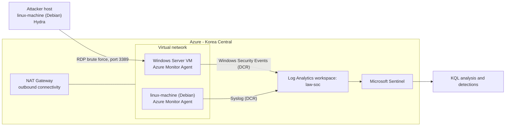

# Architecture and design

## Diagram

## How data flows
1. The attacker runs Hydra from `linux-machine` against RDP on the Windows Server VM, which I own, inside the same virtual network.
2. Each failed or successful logon is written to the Windows Security log on that VM.
3. The Azure Monitor Agent reads the events that the Data Collection Rule selects and sends them to the Log Analytics workspace (`law-soc`, resource group `RG-SOC`, Korea Central). `linux-machine` sends Syslog the same way.
4. The VMs' managed identity lets the agent authenticate to Azure and deliver the logs.
5. Microsoft Sentinel sits on the workspace. I query the SecurityEvent table with KQL to see failed logons (Event ID 4625) and successful logons (4624).
6. Analytics rules turn those queries into alerts and incidents (see the detections folder).

## Design decisions
- **Azure Monitor Agent with Data Collection Rules:** the current Microsoft agent, and the rules let me choose which events to collect instead of sending everything.
- **One workspace for all hosts:** one place to query Windows and Linux logs together.
- **Attack only my own hosts:** every simulation targets VMs I created for this lab, from `linux-machine`, also a VM I own.
- **NAT Gateway:** gives the VMs outbound connectivity.

## Network and exposure
RDP (port 3389) on the Windows Server VM is not open to the internet. An NSG rule allows inbound TCP 3389 only from a single source IP address (the attacker host's own public IP) to the VM's private IP; every other source is denied by the NSG's default deny rule. This kept the brute-force test confined to a host I control rather than exposing RDP broadly.
