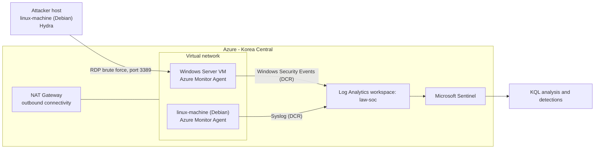

# Architecture and design

## Diagram

## How data flows
1. The attacker runs Hydra from `linux-machine` against RDP on the Windows Server VM, which I own, inside the same virtual network.
2. Each failed or successful logon is written to the Windows Security log on that VM.
3. The Azure Monitor Agent reads the events that the Data Collection Rule selects and sends them to the Log Analytics workspace (`law-soc`, resource group `RG-SOC`, Korea Central). `linux-machine` sends Syslog the same way.
4. The VMs' managed identity lets the agent authenticate to Azure and deliver the logs.
5. Microsoft Sentinel sits on the workspace. I query the SecurityEvent table with KQL to see failed logons (Event ID 4625) and successful logons (4624).
6. Analytics rules turn those queries into alerts and incidents (see the detections folder).

## Design decisions
- **Azure Monitor Agent with Data Collection Rules:** the current Microsoft agent, and the rules let me choose which events to collect instead of sending everything.
- **One workspace for all hosts:** one place to query Windows and Linux logs together.
- **Attack only my own hosts:** every simulation targets VMs I created for this lab, from `linux-machine`, also a VM I own.
- **NAT Gateway:** gives the VMs outbound connectivity.

## Network and exposure

Admin access to the VMs is currently direct RDP/SSH from my own machine: an
NSG rule (`nsg-soc`) allows inbound TCP 3389 and TCP 22 only from my own
public IP, to each VM's private IP, with every other source denied by the
NSG's default deny rule. This also means Win-2's RDP port is reachable from
the internet by anyone, just not permitted past the NSG unless the source
IP matches mine.

The Hydra brute-force test itself did not go through this NSG rule at all:
it ran from `linux-machine` directly to Win-2 over the internal virtual
network, VM-to-VM, using private IPs only. The NSG's public-facing rule and
the brute-force detection are two separate things; the detection would
catch this kind of attack even if it came from outside, since it keys off
repeated 4625 events with LogonType 3, not off where the traffic entered
the network.

**Planned improvement:** replace direct public RDP/SSH access with Azure
Bastion, which connects over HTTPS through the Azure Portal and requires no
public IP on the VM at all. This would remove the exposure that made the
brute-force test possible in the first place. Bastion is shown in the
architecture diagram as the target design, it is not deployed yet.
