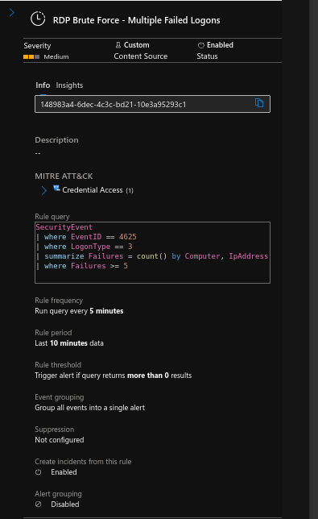
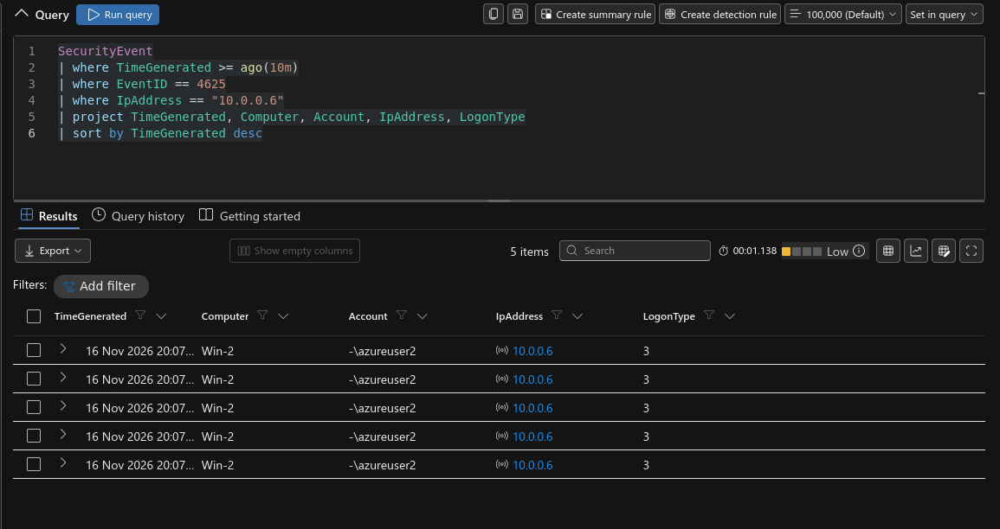

# Detections

Rules that run on their own and raise alerts, built from the hunting queries in [events](../events/) and [kql](../kql/).

| Detection | Platform | Runs | Severity | MITRE ATT&CK | Write-up |
|-----------|----------|------|----------|--------------|----------|
| RDP brute force: multiple failed logons | Microsoft Sentinel scheduled query rule | Every 5 minutes, 10 minute lookback | Medium | T1110 | [Below](#rdp-brute-force---multiple-failed-logons) |
| Fileless attack chain | Microsoft Defender custom detection | Continuous (near real time) | High | T1059.001, T1218.005, T1547.001 | [fileless-chain-rule.md](fileless-chain-rule.md) |
| Local account created (ghost account) | Microsoft Defender custom detection | Continuous (near real time) | Medium | T1136.001 | [ghost-account-rule.md](ghost-account-rule.md) |

Not yet a rule: accounts that are created and deleted within seconds. That hunting query is in [events/ghost-account](../events/ghost-account/). The rule below alerts on the account creation itself.

## RDP Brute Force - Multiple Failed Logons

A Scheduled query rule in Microsoft Sentinel, built from the hunting query
in [events/rdp-bruteforce](../events/rdp-bruteforce/) and turned into a
live, recurring detection rather than a one-off query.



### Configuration
- **Severity:** Medium
- **MITRE ATT&CK:** Credential Access, T1110 - Brute Force
- **Schedule:** runs every 5 minutes, looking back 10 minutes
- **Threshold:** alerts if the query returns more than 0 rows
- **Event grouping:** all matching rows from one run are grouped into a
  single alert, since each row already represents a qualifying burst (5+
  failures in a 1-minute window) rather than an individual failed logon

```kql
SecurityEvent
| where EventID == 4625
| where LogonType == 3
| summarize Failures = count() by Computer, IpAddress, bin(TimeGenerated, 1m)
| where Failures >= 5
```

### Validation
The rule was tested against real Hydra traffic generated in this lab, not
just reviewed on paper. Raw `SecurityEvent` rows confirmed the failed
logons landed correctly before the rule was checked:



The rule picked this up and created incidents in Microsoft Sentinel:


### Note
The rule was run against three separate manual Hydra test runs, producing
three separate incidents, one per run, since the rule's own alert
grouping setting is left disabled. A single sustained attack within one
run would still correctly collapse into one alert, because of the event
grouping setting. Separate attack runs, even close together in time,
still produce separate incidents unless alert grouping (which groups
alerts across multiple rule runs) is explicitly enabled.

## Fileless Attack Chain

A near-real-time custom detection rule in the Microsoft Defender portal, running on the `SecurityEvent` table of the Sentinel workspace. It matches process creation events (EventID 4688) whose command line shows `mshta`, a PowerShell download cradle (`IEX` with `DownloadString`), or `reg.exe` adding a Run key.

- **Severity:** High
- **MITRE ATT&CK:** T1059.001, T1218.005, T1547.001
- **Query:** [kql/fileless-chain-rule.kql](../kql/fileless-chain-rule.kql)
- **Hunt that led to it:** [kql/fileless-chain-hunt.kql](../kql/fileless-chain-hunt.kql)
- **Validation:** on creation the rule raised 4 High alerts from the 18 Nov 2026 Atomic Red Team activity on Win-1, grouped into one case. A fresh test to measure the detection delay is still pending.

Full write-up with evidence, design decisions and limitations: [fileless-chain-rule.md](fileless-chain-rule.md)

## Local Account Created (Ghost Account)

A near-real-time custom detection rule in the Microsoft Defender portal, running on the `SecurityEvent` table of the Sentinel workspace. It alerts on every EventID 4720 (a user account was created), because local account creation on a server is rare and can indicate persistence.

- **Severity:** Medium
- **MITRE ATT&CK:** T1136.001
- **Query:** [kql/ghost-account-rule.kql](../kql/ghost-account-rule.kql)
- **Hunt that led to it:** [events/ghost-account](../events/ghost-account/)
- **Validation:** on creation the rule raised 1 Medium alert from the 17 Nov 2026 account creation on Win-2. A fresh test to measure the detection delay is still pending.

Full write-up: [ghost-account-rule.md](ghost-account-rule.md)
