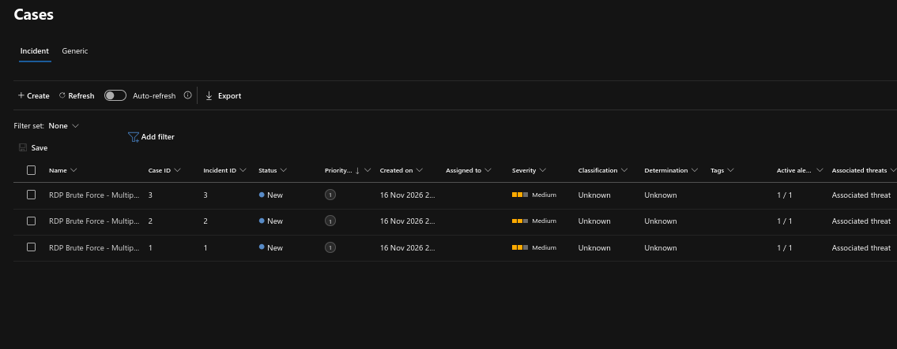

# Detections

## RDP Brute Force - Multiple Failed Logons

A Scheduled query rule in Microsoft Sentinel, built from the hunting query
in [events/rdp-bruteforce](../events/rdp-bruteforce/) and turned into a
live, recurring detection rather than a one-off query.


### Configuration
- **Severity:** Medium
- **MITRE ATT&CK:** Credential Access, T1110 - Brute Force
- **Schedule:** runs every 5 minutes, looking back 10 minutes
- **Threshold:** alerts if the query returns more than 0 rows
- **Event grouping:** all matching rows from one run are grouped into a
  single alert, since each row already represents a qualifying burst (5+
  failures in a 1-minute window) rather than an individual failed logon

```kql
SecurityEvent
| where EventID == 4625
| where LogonType == 3
| summarize Failures = count() by Computer, IpAddress, bin(TimeGenerated, 1m)
| where Failures >= 5
```

### Validation
The rule was tested against real Hydra traffic generated in this lab, not
just reviewed on paper. Raw `SecurityEvent` rows confirmed the failed
logons landed correctly before the rule was checked:


The rule picked this up and created incidents in Microsoft Sentinel:



### Note
The rule was run against three separate manual Hydra test runs, producing
three separate incidents, one per run, since the rule's own alert
grouping setting is left disabled. A single sustained attack within one
run would still correctly collapse into one alert, because of the event
grouping setting. Separate attack runs, even close together in time,
still produce separate incidents unless alert grouping (which groups
alerts across multiple rule runs) is explicitly enabled.
