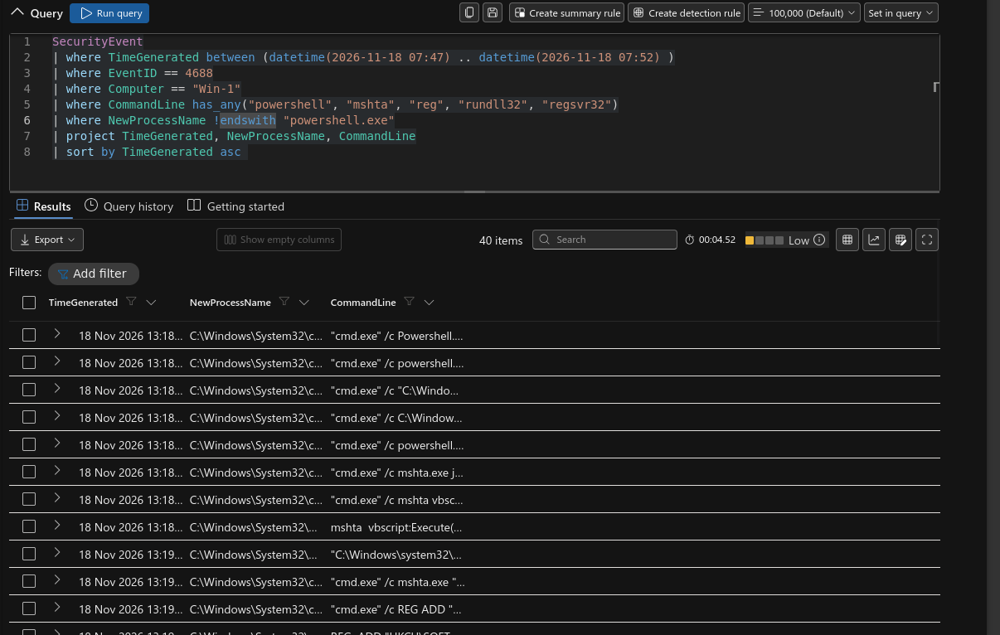
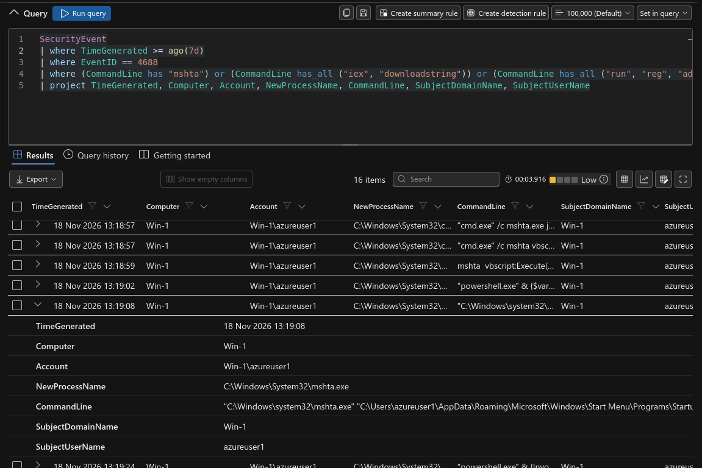
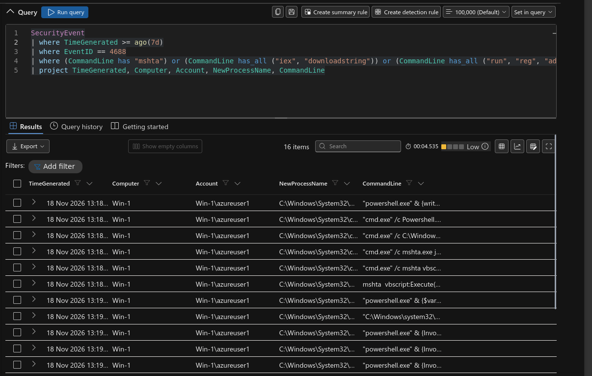
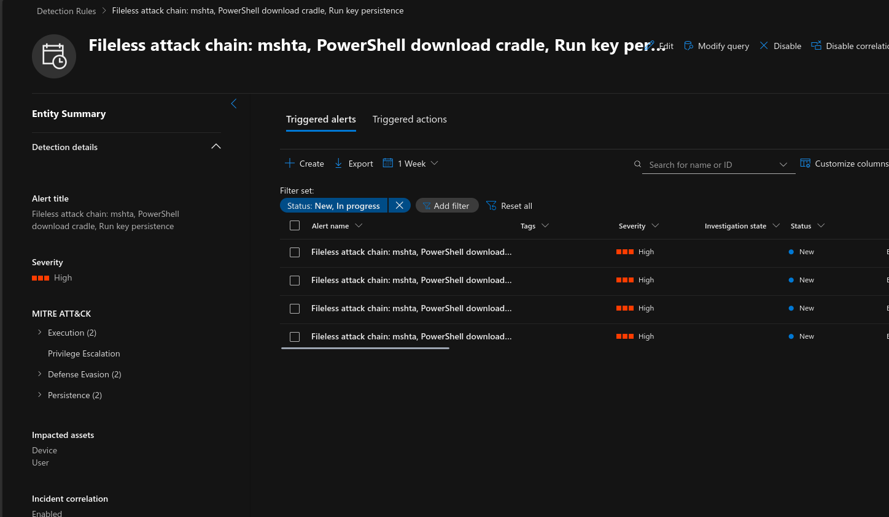
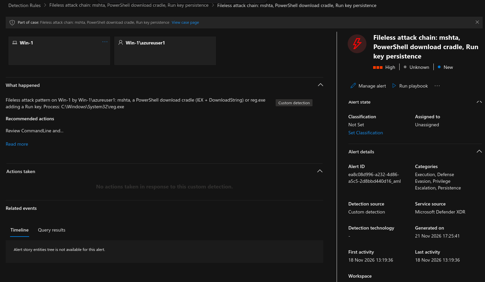
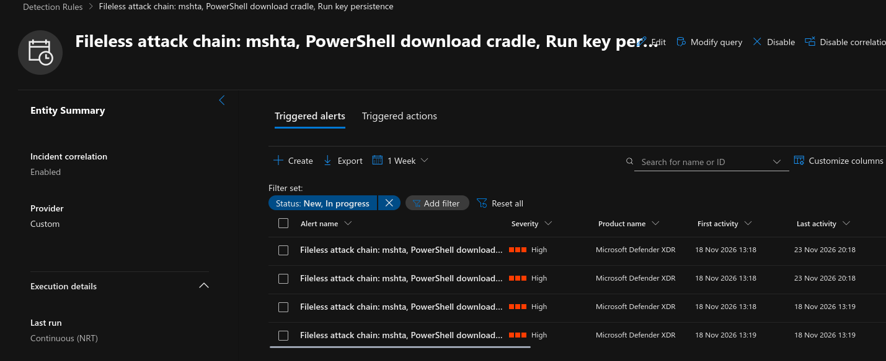

# Detection: fileless attack chain on Windows (mshta, PowerShell cradle, Run key)

## Summary

A near-real-time (NRT) custom detection rule in the Microsoft Defender portal. It runs on the `SecurityEvent` table of my Sentinel workspace and looks at process creation events (EventID 4688), which carry the full command line.

## Why detect behaviour, not files

A fileless attack leaves little or nothing on disk, so file scanning has nothing to find. The commands that run are visible, so the rule matches the command line instead.

## Evidence from the hunt

Win-1, 18 Nov 2026, 13:18 to 13:21 IST (07:48 to 07:51 UTC), generated with Atomic Red Team. All commands ran under one local account, `Win-1\azureuser1`.

| Behaviour seen | MITRE technique |
|---|---|
| PowerShell download cradle (`IEX` with `DownloadString`) | T1059.001 |
| `mshta` fetching a remote scriptlet | T1218.005 |
| `REG ADD` into the `CurrentVersion\Run` key | T1547.001 |
| `mshta.exe` opening a `.hta` file from the Startup folder | T1218.005, T1547.001 |

The hunt query returned 40 rows for the five-minute window:



The `mshta` row that opened a file from the Startup folder, expanded.


`mshta.exe` opening a file from the Startup folder (13:19:08):



## Rule query

```kusto
SecurityEvent
| where EventID == 4688
| where (CommandLine has "mshta") or (CommandLine has_all ("iex", "downloadstring")) or (CommandLine has_all ("run", "reg", "add", "currentversion"))
| project TimeGenerated, Computer, Account, NewProcessName, CommandLine, SubjectDomainName, SubjectUserName
```

Test run over the previous 7 days (a time line was added only for this test and is not part of the rule):



## Rule settings

| Setting | Value |
|---|---|
| Frequency | Continuous (NRT), so no lookback period |
| Severity | High |
| MITRE | T1059.001, T1218.005, T1547.001 |
| Impacted assets | Device: HostName from `Computer`. User: NTDomain from `SubjectDomainName`, Name from `SubjectUserName` |
| Incident correlation | Enabled |
| Automated actions | None |



## Design decisions

- **No time filter and no `Computer` filter.** The rule's own schedule replaces the fixed window used in the hunt, and the rule has to watch every machine.
- **`has "mshta"` on its own.** A stricter version (`mshta` plus a URL or script word) returned 12 rows. This version returned 16, and one of the extra rows was `mshta.exe` opening a file from the Startup folder, which the stricter version missed.
- **`has_all` for the Run key.** Requiring all four words keeps ordinary uses of `reg` out.
- **No automated response.** Isolating a lab VM would lock me out of it, and in production a human should confirm first.
- **User identity as NTDomain + Name.** The account is a local account, so UPN and Entra identifiers do not apply. `SubjectDomainName` and `SubjectUserName` matched the `Account` column in the results.

## Validation

- Run over the previous 7 days, the query returned 16 rows, all from Win-1.
- When the rule was created it generated 4 High alerts from the 18 Nov events. The alert shows Win-1 and `Win-1\azureuser1` as entities, and the alerts were grouped into one case. The alert was generated on 21 Nov, when the rule was created, and its activity time is 18 Nov.



- Fresh test (23 Nov 2026): Atomic Red Team T1218.005 test 2 (mshta runs VBScript that launches a local PowerShell command) was run on Win-1. The CommandLine was confirmed in SecurityEvent within minutes of execution. The rule did not raise a new alert row; instead the new events were added to the existing alerts for the same device and user (Win-1, azureuser1), with Last activity updated to 23 Nov 20:18. This was visible on the rule's Triggered alerts page within about 15 minutes of the test.
- Because the match merged into an existing alert rather than creating a new one, there is no fresh Generated on time to measure an exact detection delay against, unlike the ghost account rule's fresh test. The ~15 minute figure is an upper bound based on when the page was checked, not a precise measurement.



## Limitations

- It needs command line logging in 4688 events, which depends on the audit policy.
- The word match can be fooled by obfuscated commands, and `has_all` can match harmless commands that contain those words.
- It does not cover PowerShell started by other binaries unless the command line contains the same words.
