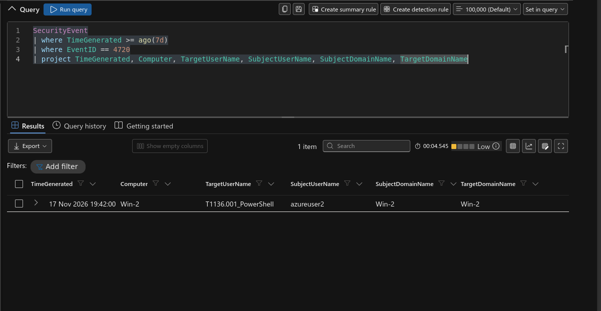
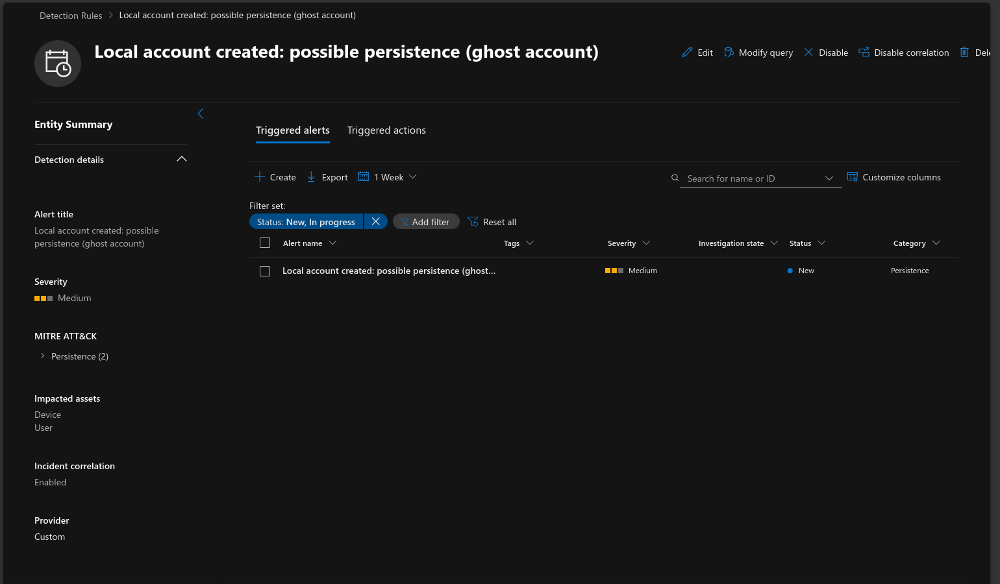
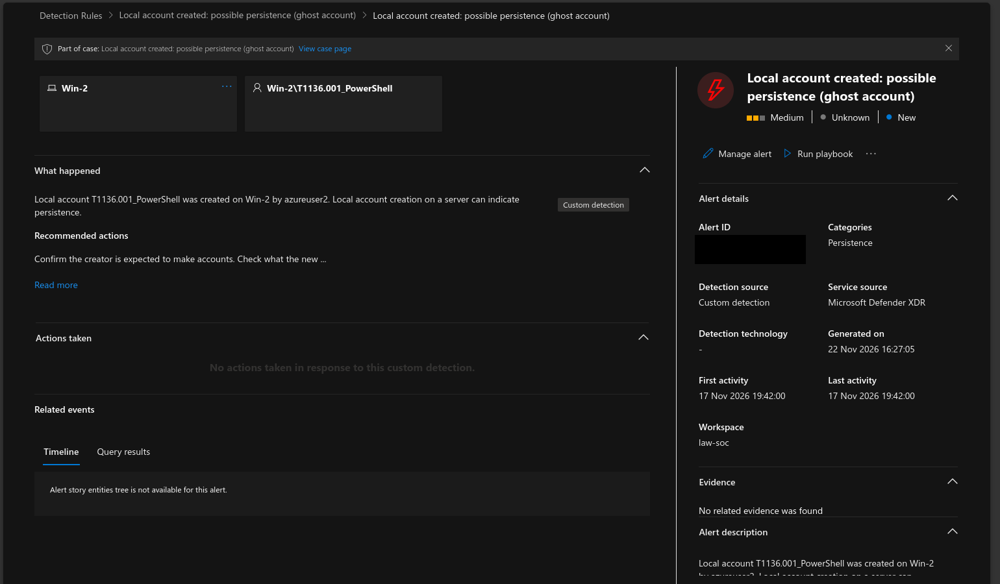
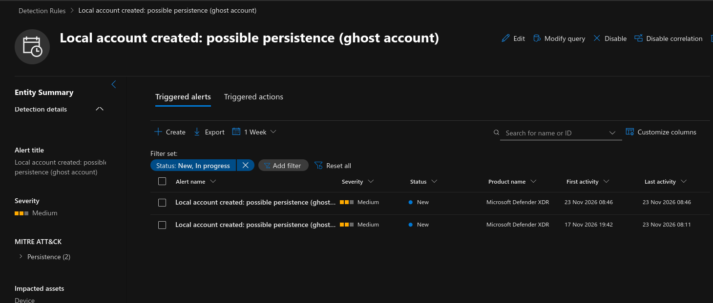

# Detection: local account created (ghost account)

## Summary

A near-real-time (NRT) custom detection rule in the Microsoft Defender portal. It runs on the `SecurityEvent` table of my Sentinel workspace and alerts on every EventID 4720 (a user account was created).

## Why alert on the creation

The earlier hunt in [events/ghost-account](../events/ghost-account/) measured how long a short-lived account existed. That query only sees accounts that were created and then deleted. A rule that looked for accounts that were created and never deleted would be too noisy, because most legitimate accounts are never deleted. The creation itself, together with who made the account, is the useful signal. Local account creation on a server is rare.

## Evidence from the hunt

Win-2, 17 Nov 2026, generated with Atomic Red Team technique T1136.001. The account `T1136.001_PowerShell` was created by `Win-2\azureuser2` at 19:42:00 IST and deleted 41 seconds later.

## Rule query

```kusto
SecurityEvent
| where EventID == 4720
| project TimeGenerated, Computer, TargetUserName, SubjectUserName, SubjectDomainName, TargetDomainName
```

Test run over the previous 7 days (a time line was added only for this test and is not part of the rule):



## Rule settings

| Setting | Value |
|---|---|
| Frequency | Continuous (NRT), so no lookback period |
| Severity | Medium |
| MITRE | T1136.001 (Create Account: Local Account) |
| Impacted assets | Device: HostName from `Computer`. User: NTDomain from `TargetDomainName`, Name from `TargetUserName` |
| Incident correlation | Enabled |
| Automated actions | None |



## Design decisions

- **Alert on the creation, not on "never deleted".** Most legitimate accounts are never deleted, so that rule would flag every normal account.
- **No time filter and no `Computer` filter.** The rule's own schedule replaces a fixed window, and the rule has to watch every machine.
- **Impacted user is the account that was created.** The creator (`SubjectUserName`) is named in the alert description, so the analyst can see who made it.
- **Medium severity.** One account creation is weaker evidence than the fileless attack chain. A rule on accounts that are created and deleted within seconds would be a stronger signal and could be a later rule with higher severity.
- **No automated response.** A human should check whether the creator is expected before anything is disabled.

## Validation

- When the rule was created it raised 1 Medium alert from the 17 Nov event. The alert shows `Win-2` and `Win-2\T1136.001_PowerShell` as entities, and it was grouped into a case. The alert was generated on 22 Nov, when the rule was created, and its activity time is 17 Nov.



- Fresh test (23 Nov 2026): Atomic Red Team T1136.001 test 4 (local account created from a command prompt) was run on Win-2. The 4720 event was logged at 08:46:22 and the alert was generated at 08:50:41, so the delay from event to alert was about 4 minutes 20 seconds. Cleanup removed the account the same minute (event 4726) and the alert still fired. The test account had a different name from the first test, so it produced a separate alert instead of merging into the existing one.
- This is a single sample. The delay includes log ingestion and rule processing, so it is not a benchmark.



## Limitations

- It alerts on every local account creation, so a legitimate provisioning script would trigger it. Tuning would need a list of expected creators.
- The alert shows no related evidence beyond the account, the creator and the machine.
- It depends on account management auditing producing 4720 events.
