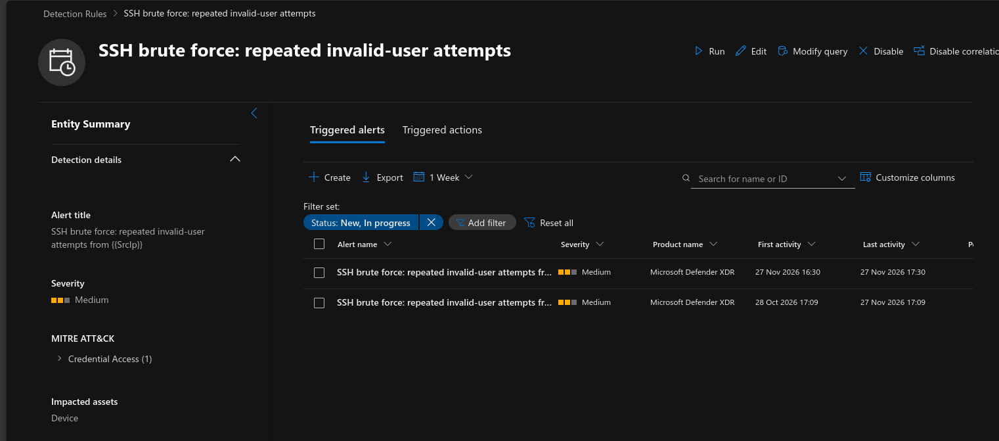
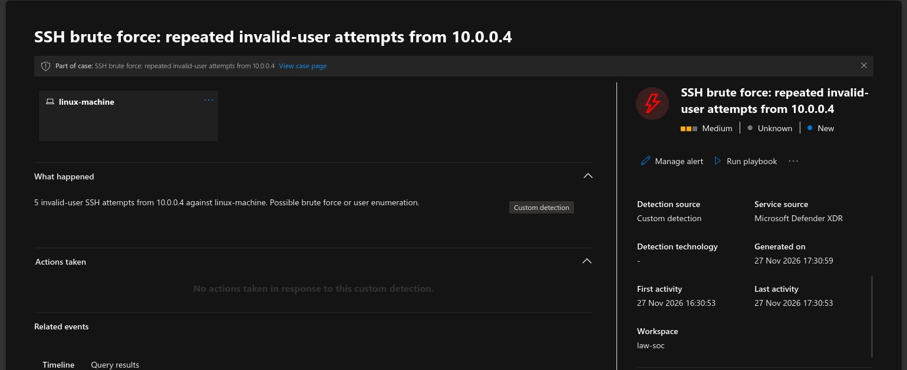

# SSH brute force: repeated invalid-user attempts

A custom detection that alerts when one source makes five or more invalid-user SSH attempts against a Linux host within one hour.

| Field | Value |
|---|---|
| Log source | Syslog from linux-machine (Debian), collected by Azure Monitor Agent |
| Technique | T1110 Brute Force (Credential Access) |
| Severity | Medium |
| Frequency | Every hour |
| Lookback | 1 hour |
| Threshold | 5 or more attempts per source per window |
| Entities | Device (HostName = Computer), IP (Address = SrcIp) |

## Why this logic

linux-machine only accepts key-based SSH, so a failed login ends with `Permission denied (publickey)` and a "Failed password" line never appears. The reliable signal is the `Invalid user <name> from <ip> port <n>` line that sshd writes once per attempt against a non-existent account. The rule matches that line with `startswith`, because `has` would also match the second line sshd writes for the same attempt and double the count.

## Rule query

```kusto
Syslog
| where ProcessName == "sshd"
| where SyslogMessage startswith "Invalid user"
| parse SyslogMessage with "Invalid user " User " from " SrcIp " port " Port:int
| summarize attempts = count(), accounts = dcount(User), FirstSeen = min(TimeGenerated), LastSeen = max(TimeGenerated) by Computer, SrcIp
| where attempts >= 5
```

Query files: [rule](../kql/ssh-brute-force-rule.kql), [hunting version](../kql/ssh-brute-force-hunt.kql).

## Alert settings

- Title: `SSH brute force: repeated invalid-user attempts from {{SrcIp}}`
- Description: `{{attempts}} invalid-user SSH attempts from {{SrcIp}} against {{Computer}}. Possible brute force or user enumeration.`
- The wizard allows at most three `{{column}}` placeholders in a description, which is why `accounts`, `FirstSeen` and `LastSeen` are not used there.

## Validation

- When the rule was created it ran once over 30 days of data and produced an alert with 12 attempts. Its first activity shows the edge of that 30 day window, so it is not a fresh detection.
- Fresh test: five invalid-user SSH attempts were typed by hand from Win-1 against linux-machine using a non-existent account.
- The hunting query placed the five attempts in the 11:40 to 11:50 UTC bin. The time check taken after the last attempt was 11:49:56 UTC.
- The rule produced a new alert with five attempts, generated at 12:00:59 UTC, no later than about 11 minutes after the last attempt. Five is exactly the threshold.
- The alert's first and last activity (11:00:53 to 12:00:53 UTC) are the one hour window the rule scanned, not the time of the attempts.
- This test did not record whether that run was the hourly schedule or a manual Run.
- Portal screenshots show IST (UTC+5:30), so 17:30:59 IST is 12:00:59 UTC.





## Limitations

- Only attempts against non-existent accounts produce the `Invalid user` line. Failed attempts against a real account on a key-only server use different wording and are not counted.
- The hourly schedule means detection can take up to about one hour plus log ingestion. This is a single sample, not a benchmark.
- The count is per source address, so many hosts behind one NAT address can trigger it, and a slow attacker who stays under five attempts per hour will not.
- The threshold of five is a lab value, not a tuned production value.
- The rule only raises an alert. There is no automated response.
