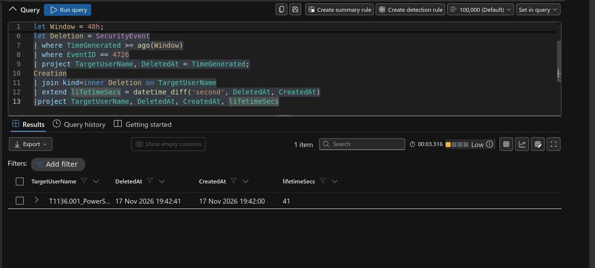

# Ghost Account: Local Account Created and Deleted Within Seconds

## Summary

A local account was created and then deleted on Win-2 using Atomic Red Team. The account's lifetime was then measured with KQL in Microsoft Sentinel (workspace `law-soc`) from the Windows Security events.

## MITRE ATT&CK

| Tactic | Technique | ID |
|---|---|---|
| Persistence | Create Account: Local Account | T1136.001 |

## Simulation

- VM: Win-2
- Tool: Atomic Red Team, technique T1136.001 (a PowerShell account-creation test), followed by the test cleanup
- Account created: `T1136.001_PowerShell`
- Performed by: `Win-2\azureuser2`
- Simulation date: 17 Nov 2026
- Queries run: 18 Nov 2026, against logs already stored in the workspace

## Evidence

| EventID | Meaning | Portal time (IST) | UTC |
|---|---|---|---|
| 4720 | A user account was created | 17 Nov 2026 19:42:00 | 14:12:00 |
| 4726 | A user account was deleted | 17 Nov 2026 19:42:41 | 14:12:41 |

The Defender portal displays times in IST (UTC+5:30).

## Detection logic: short-lived accounts

An attacker with admin rights can create a local account for persistence, use it, and delete it to leave less behind. Legitimate accounts usually live for months, so a gap of seconds or minutes between event 4720 (created) and event 4726 (deleted) is worth a look.

```kusto
let Window = 48h;
let Creation = SecurityEvent
| where TimeGenerated >= ago(Window)
| where EventID == 4720
| project TargetUserName, CreatedAt = TimeGenerated;
let Deletion = SecurityEvent
| where TimeGenerated >= ago(Window)
| where EventID == 4726
| project TargetUserName, DeletedAt = TimeGenerated;
Creation
| join kind=inner Deletion on TargetUserName
| extend lifetimeSecs = datetime_diff('second', DeletedAt, CreatedAt)
| project TargetUserName, DeletedAt, CreatedAt, lifetimeSecs
```

How it works:

- `Creation` keeps every 4720 event with the account name and the time, renamed `CreatedAt`.
- `Deletion` keeps every 4726 event the same way, with the time renamed `DeletedAt`.
- `join kind=inner` matches the two on `TargetUserName`, so only accounts that appear in both survive.
- `datetime_diff` turns the two times into the number of seconds the account existed.

## Result



The account `T1136.001_PowerShell` lived for 41 seconds.

## Limitations

- This is a hunting query, not a detection rule. A rule would add a threshold on `lifetimeSecs` and a shorter window.
- The inner join hides accounts that were created and never deleted, which is the more common persistence case. That needs a separate query.
- Expect some false positives, such as test accounts or provisioning scripts that create and remove accounts quickly.
- `ago(Window)` counts back from the moment the query runs, so the window must be widened for older events.
