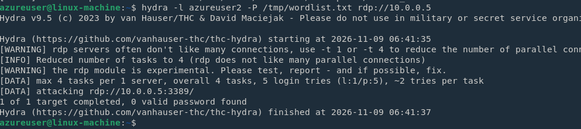
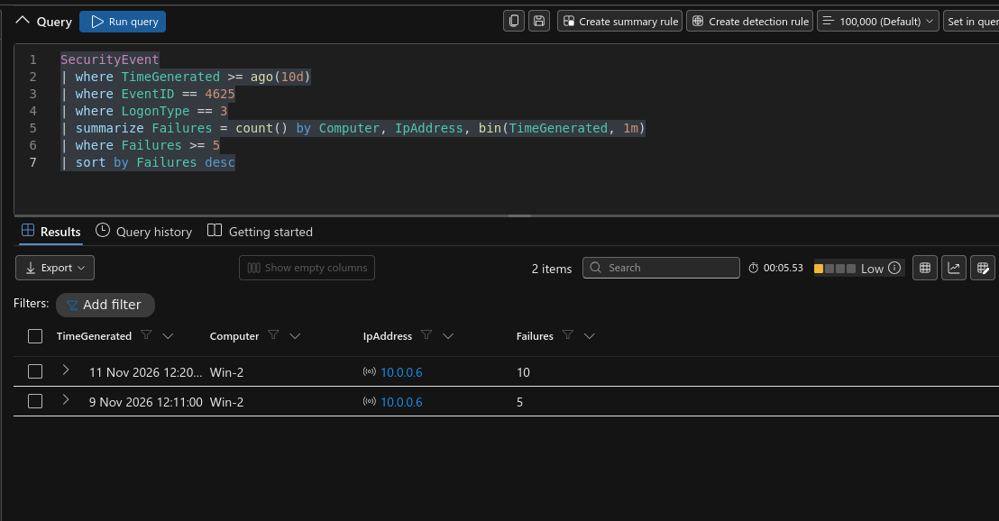
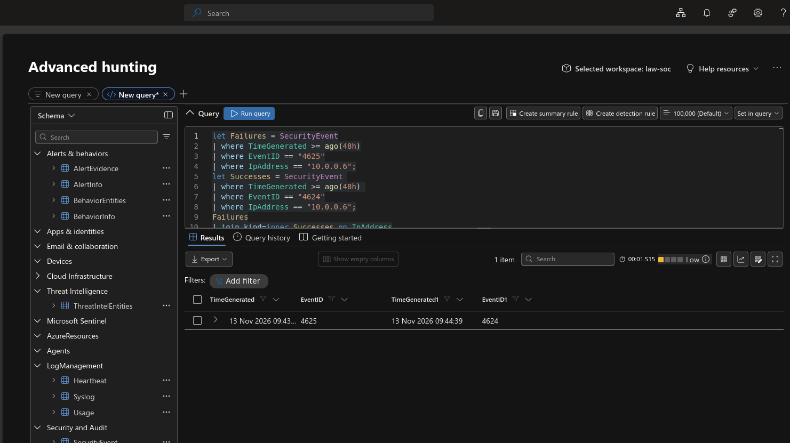

# Event: RDP brute force

## Setup
A brute-force attack against RDP (port 3389) on my own Windows Server VM
(`Win-2`), using Hydra from `linux-machine`, a second VM I own in the same
lab. Two separate runs were made, on 9 November and 11 November 2026.

## Evidence
Windows Security Events in the `SecurityEvent` table: Event ID 4625
(failed logon) and 4624 (successful logon).

## Findings

### The attack
Hydra was run from `linux-machine` against `Win-2`'s RDP service, using a
local wordlist:

```
hydra -l azureuser2 -P /tmp/wordlist.txt rdp://10.0.0.5 -t 4
```



### Detection
RDP logons that go through Network Level Authentication show up as
`LogonType == 3` (network logon) rather than `LogonType == 2`
(interactive), so the detection filters on that logon type to avoid
picking up unrelated interactive failures such as a mistyped password at
the console. Failures are grouped into 1-minute windows and flagged once
5 or more happen from the same computer and source IP in that window,
since a real brute-force run produces many failures in a short burst,
not one every few minutes.

```kql
SecurityEvent
| where TimeGenerated >= ago(10d)
| where EventID == 4625
| where LogonType == 3
| summarize Failures = count() by Computer, IpAddress, bin(TimeGenerated, 1m)
| where Failures >= 5
| sort by Failures desc
```

| Date | Computer | Source IP | Failures |
|------|----------|-----------|----------|
| 11 Nov 2026 12:20 | Win-2 | 10.0.0.6 (linux-machine) | 10 |
| 9 Nov 2026 12:11 | Win-2 | 10.0.0.6 (linux-machine) | 5 |



The wordlist used on 9 November had 5 lines and the one used on 11
November had 10 lines; both match the failure counts exactly, confirming
these were the two Hydra runs rather than any other failed logon
activity.

### Correlating failure with success
```kql
let Failures = SecurityEvent
    | where TimeGenerated >= ago(10d)
    | where EventID == "4625"
    | where IpAddress == "10.0.0.6";
let Successes = SecurityEvent
    | where TimeGenerated >= ago(10d)
    | where EventID == "4624"
    | where IpAddress == "10.0.0.6";
Failures
| join kind=inner Successes on IpAddress
```

This join returns one correlated pair: a failure and a success from the
same source IP (10.0.0.6) on 13 November, a few seconds apart. That pair
is from a separate, manual `xfreerdp` test, not from either Hydra run,
since neither Hydra run guessed the correct password.



## Notes
- This event and the manual `xfreerdp` test on 13 November are separate
  activities: the Hydra runs on 9 and 11 November never guessed the
  correct password, so neither produced a successful logon.
- The manual test on 13 November used the real account password once,
  deliberately, to confirm what a successful logon looks like in
  `SecurityEvent`.
