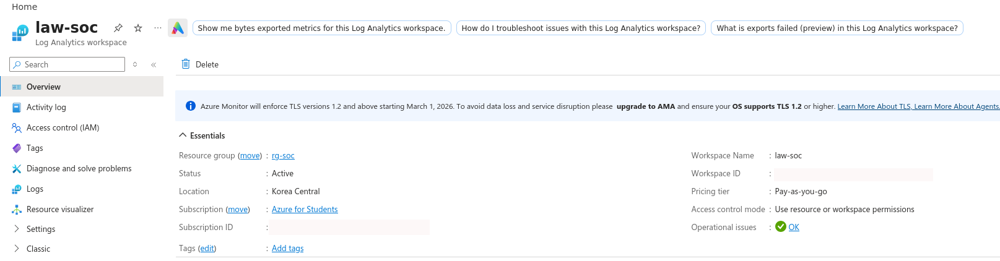
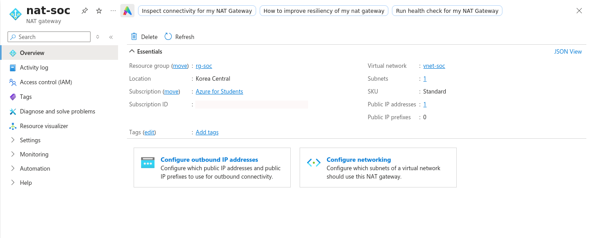
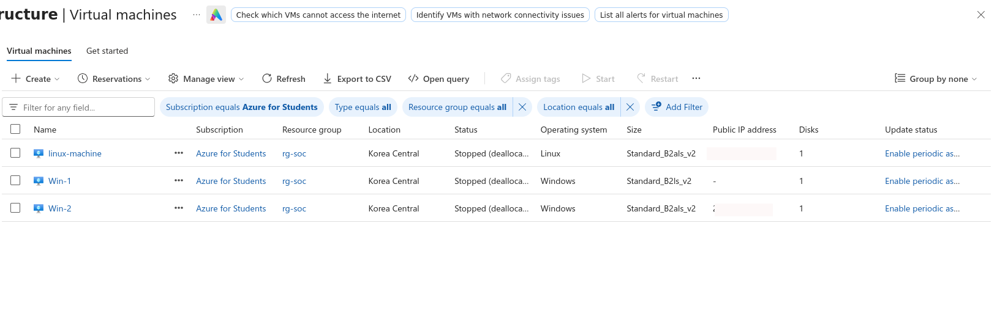
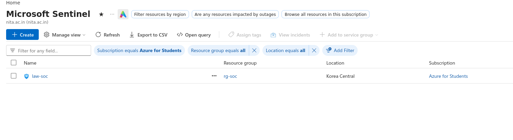
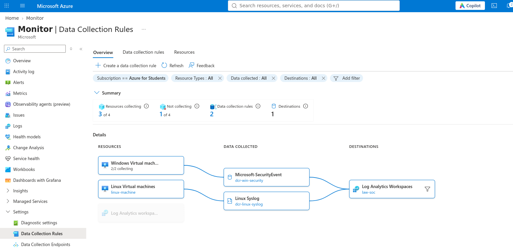
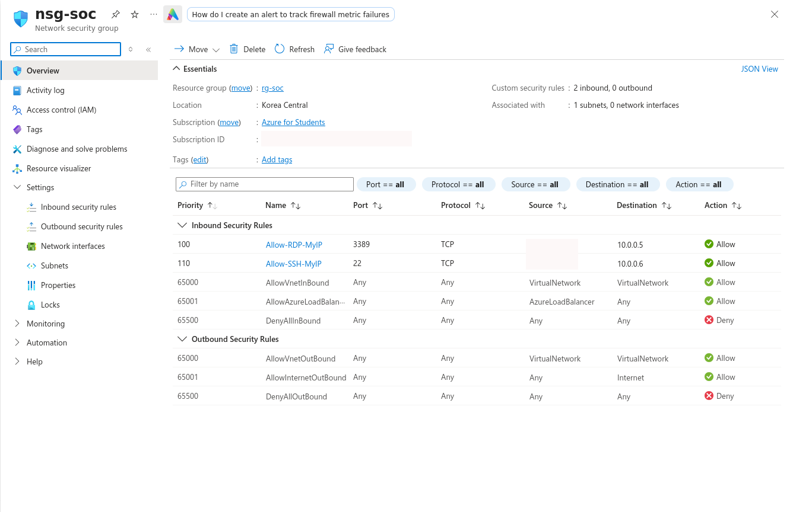
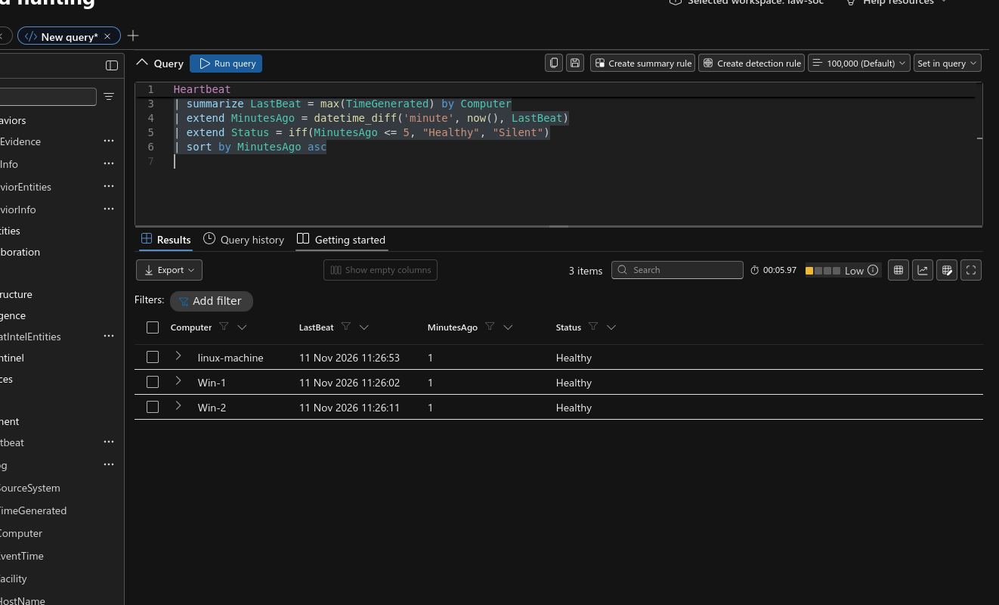

# Setup

Steps to rebuild this lab from scratch.

## 1. Resource group and workspace
1. Create a resource group, `RG-SOC`, in Korea Central.
2. Create a Log Analytics workspace, `law-soc`, in the same resource group and region.



## 2. Virtual network and NAT Gateway
3. Create a virtual network for the lab's VMs.
4. Create and attach a NAT Gateway to the virtual network's subnet, so VMs without a public IP still get outbound connectivity.



## 3. Virtual machines
5. Deploy a Windows Server VM. This is the brute-force target.
6. Deploy `linux-machine`, a Debian VM. This is the Hydra attack source and a second log source.
7. Give each VM a system-assigned managed identity (required for the Azure Monitor Agent to authenticate to the workspace). This was a real failure point: logs silently stopped arriving until the missing identity was added; see `troubleshooting.md`.



## 4. Microsoft Sentinel
8. Enable Microsoft Sentinel on the `law-soc` workspace.



## 5. Data Collection Rules
9. Create a Data Collection Rule, `dcr-win-security`, that selects Windows Security Events and associate it with both Windows VMs (`Win-1` and `Win-2`).
10. Create a Data Collection Rule, `dcr-linux-syslog`, that selects Syslog and associate it with `linux-machine`.



## 6. Network security group
11. On the Windows Server VM's NSG, add an inbound rule allowing TCP 3389 only from the attacker host's own public IP, denying it from everywhere else by default.



## 7. Verify ingestion
12. Confirm both hosts are reporting:

```kql
Heartbeat
| where TimeGenerated >= ago(15m)
| summarize LastBeat = max(TimeGenerated) by Computer
| extend MinutesAgo = datetime_diff('minute', now(), LastBeat)
| extend Status = iff(MinutesAgo <= 5, "Healthy", "Silent")
| sort by MinutesAgo asc
```



## Notes
- VM auto-shutdown may be enabled depending on subscription type. If a VM shows "no data" in Sentinel, check its power state in the Azure Portal before assuming a query or connector problem; after starting a VM, allow a few minutes for Heartbeat and SecurityEvent to resume.
